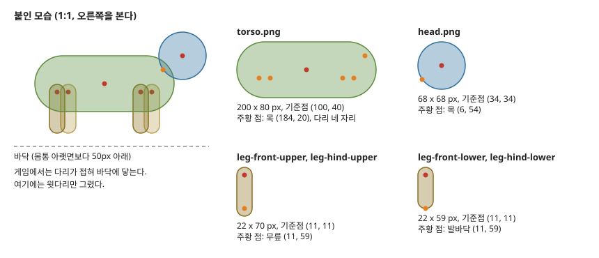

# 토리 부위별 그림 규격표

토리는 부위마다 그림 한 장씩을 붙여서 움직입니다. 아래 크기에 맞춘 PNG를 `src/assets/parts/` 폴더에 넣으면 다음 배포부터 도형 대신 그림이 나옵니다. 일부만 넣어도 됩니다. 아직 없는 부위는 지금처럼 도형으로 나옵니다.

모든 치수는 지금 프로토타입에 들어 있는 자리값입니다. 몸의 비율이나 자세(엎드린 모습, 선 모습)를 바꾸고 싶으면 먼저 말씀해 주세요. 치수를 고친 뒤 이 표도 다시 냅니다.

## 공통 규칙

- 투명 배경 PNG로 만듭니다. 픽셀 아트가 아니라 경계가 부드러운 일반 그림입니다.
- 모든 그림은 오른쪽을 보는 옆모습입니다. 왼쪽을 볼 때는 게임이 좌우로 뒤집습니다.
- 해상도는 1m당 200px입니다. 화면(1280×720 기준)에는 절반 크기인 1m당 100px로 나옵니다.
- 기준점은 그림을 붙이고 돌리는 중심입니다. 왼쪽 위가 (0, 0)입니다.
- 볏이나 등 돌기처럼 기본 크기 밖으로 나가는 부분이 있으면 캔버스를 키워도 됩니다. 이때 위와 아래는 서로 같은 폭으로, 왼쪽과 오른쪽도 서로 같은 폭으로 넓혀서 기본 크기의 네모가 캔버스 한가운데에 남게 합니다. 충돌 범위는 그림과 상관없이 기본 크기 그대로입니다.

## 부위

| 부위 | 파일 이름 | 기본 크기 (파일) | 화면 크기 | 기준점 (파일) | 기준점이 가리키는 곳 |
|---|---|---|---|---|---|
| 몸통 | `torso.png` | 200×80 px | 100×40 px | (100, 40) | 몸통 한가운데 |
| 머리 | `head.png` | 68×68 px | 34×34 px | (34, 34) | 머리 한가운데 |
| 앞다리 위 | `leg-front-upper.png` | 22×70 px | 11×35 px | (11, 11) | 몸통에 붙는 관절 |
| 앞다리 아래 | `leg-front-lower.png` | 22×71 px | 11×35.5 px | (11, 11) | 팔꿈치 |
| 뒷다리 위 | `leg-hind-upper.png` | 22×70 px | 11×35 px | (11, 11) | 몸통에 붙는 관절 |
| 뒷다리 아래 | `leg-hind-lower.png` | 22×71 px | 11×35.5 px | (11, 11) | 무릎 |
| 꼬리 밑동 마디 | `tail-base.png` | 65×40 px | 32.5×20 px | (32.5, 20) | 마디 한가운데 |
| 꼬리 1구간 마디 | `tail-1.png` | 57×32 px | 28.5×16 px | (28.5, 16) | 마디 한가운데 |
| 꼬리 2구간 마디 | `tail-2.png` | 49×24 px | 24.5×12 px | (24.5, 12) | 마디 한가운데 |
| 꼬리 3구간 마디 | `tail-3.png` | 41×16 px | 20.5×8 px | (20.5, 8) | 마디 한가운데 |
| 꼬리 맨 끝 마디 | `tail-tip.png` | 41×16 px | 20.5×8 px | (20.5, 8) | 마디 한가운데 |

## 이어지는 자리

- 목: 몸통 그림의 (184, 20)과 머리 그림의 (6, 54)가 겹칩니다. 머리는 이 점을 중심으로 위아래 35도까지 흔들립니다.
- 앞다리: 몸통 그림의 (152, 52)에 가까운 쪽 다리가, (168, 52)에 먼 쪽 다리가 붙습니다.
- 뒷다리: 몸통 그림의 (32, 52)에 가까운 쪽 다리가, (48, 52)에 먼 쪽 다리가 붙습니다.
- 다리: 곧게 아래로 뻗은 모습으로 그립니다. 윗다리 그림의 (11, 59)와 아랫다리 그림의 (11, 11)이 겹치고, 아랫다리 그림의 (11, 71)이 발바닥입니다. 관절이 굽어도 틈이 보이지 않게 겹치는 끝을 둥글게 그립니다.
- 가까운 쪽과 먼 쪽 다리는 같은 그림을 씁니다. 먼 쪽은 게임이 밝기를 70%로 낮춥니다.
- 겹치는 순서는 뒤에서부터 먼 쪽 다리, 꼬리, 몸통, 머리, 가까운 쪽 다리입니다. 꼬리 안에서는 끝 마디가 맨 뒤이고 밑동 마디가 맨 앞입니다.
- 걸을 때 다리 붙는 자리는 골반과 어깨를 따라 앞뒤로 최대 8px 움직입니다. 다리를 벌린 모습이 나도록 가까운 쪽 발은 바닥선보다 8px 아래, 먼 쪽 발은 8px 위에 놓입니다.
- 서 있을 때 몸통 아랫면은 바닥에서 50px(화면에서는 25px) 떠 있습니다.

## 꼬리

- 꼬리는 마디 12개를 이어 만듭니다. 몸에 가까운 쪽부터 밑동 3마디, 1구간 3마디, 2구간 3마디, 3구간 3마디이고, 한 구간의 마디는 같은 그림을 씁니다. 맨 끝 마디만 `tail-tip.png`를 씁니다.
- 밑동은 자를 수 없고, 나머지는 끝에서부터 구간 단위로 잘립니다. 잘린 뒤의 모습은 아래 "꼬리를 자른 뒤"에 있습니다.
- 마디 그림은 가로로 누운 모습입니다. 오른쪽이 몸 쪽, 왼쪽이 꼬리 끝 쪽이고, 등이 위로 옵니다.
- 마디 사이의 간격은 25px(화면에서는 12.5px)입니다. 이웃한 마디끼리 굵기만큼 겹치므로 양 끝을 둥글게 그립니다. 관절은 그림 한가운데에서 좌우로 12.5px 떨어진 두 점이고, 한 관절이 35도까지 꺾입니다.
- 밑동은 몸통 그림의 (28, 32)에 붙습니다. 몸통 그림 뒤에 가려지는 자리입니다.
- 꼬리 전체 길이는 300px(화면에서는 150px)이고 몸통 길이(200px)의 1.5배입니다.

## 꼬리를 자른 뒤

- 꼬리를 자르면 끝에서부터 구간 하나(3마디)가 떨어집니다. 떨어진 구간은 마디끼리 이어진 채로 바닥에서 2초 동안 꿈틀거리다가, 토리가 기록관 앞으로 돌아갈 때 사라집니다. 떨어진 마디는 잘리기 전과 같은 그림을 씁니다.
- 남은 꼬리는 잘린 자리에서 뭉툭하게 끝납니다. 실제 도마뱀도 끊긴 자리가 다시 뾰족해지지 않기 때문입니다. 그래서 `tail-tip.png`는 한 번도 자르지 않은 꼬리의 맨 끝 마디에만 나오고, 한 번 자른 꼬리는 `tail-2.png` 마디로 끝납니다. 구간 그림의 왼쪽 끝(꼬리 끝 쪽)이 그대로 잘린 자리로 보이므로, 끊긴 자리를 따로 그리고 싶으면 말씀해 주세요. 그림 이름을 하나 더 정해 드리겠습니다.

## 회귀 비늘

회귀 비늘은 남은 회귀 횟수를 글 없이 보여 주는 그림입니다. 비늘 3개가 꼬리 구간 하나씩과 짝이고, 몸에 가까운 비늘부터 1구간, 2구간, 3구간과 짝입니다. 구간을 자르면 짝인 비늘이 꺼집니다. 꼬리는 끝에서부터 잘리므로 몸에서 가장 먼 비늘부터 꺼집니다.

비늘은 자를 수 없는 밑동에 나란히 붙습니다. 잘리는 구간 위에 그리면 구간과 함께 떨어져 나가서 꺼진 비늘을 볼 수 없기 때문입니다. 아래의 자리와 모양은 자리표시이고, 디자인에서 바꿔도 됩니다. 크기나 자리를 바꾸려면 숫자를 알려 주세요.

| 그림 | 파일 이름 | 기본 크기 (파일) | 화면 크기 | 기준점 (파일) |
|---|---|---|---|---|
| 켜진 비늘 | `rewind-scale.png` | 18×14 px | 9×7 px | (9, 7), 그림 한가운데 |
| 꺼진 비늘 | `rewind-scale-off.png` | 18×14 px | 9×7 px | (9, 7), 그림 한가운데 |

- 꼬리 마디처럼 가로로 누운 모습으로 그립니다. 오른쪽이 몸 쪽, 왼쪽이 꼬리 끝 쪽이고, 위가 등입니다. 꼬리가 굽으면 붙은 마디를 따라 돕니다.
- 꺼진 비늘 그림은 없어도 됩니다. 없으면 게임이 켜진 비늘 그림을 35% 밝기로 어둡게 해서 씁니다. 켜진 것과 꺼진 것은 밝기만으로도 구분되어야 합니다.
- 비늘의 한가운데는 밑동이 몸통에 붙는 자리에서 꼬리를 따라 16px, 40.5px, 65px 떨어진 곳에 있습니다(화면에서는 8px, 약 20px, 32.5px). 꼬리의 가운데 선에서 등 쪽으로 14px(화면에서는 7px) 올라간 자리라, 비늘이 밑동 그림의 위쪽 가장자리에 걸칩니다.
- 비늘은 몸통 그림보다 앞에 그립니다. 꼬리를 들어 올리면 몸에 가장 가까운 비늘이 몸통 뒤 끝과 겹칠 수 있는데, 이때도 비늘이 보입니다.
